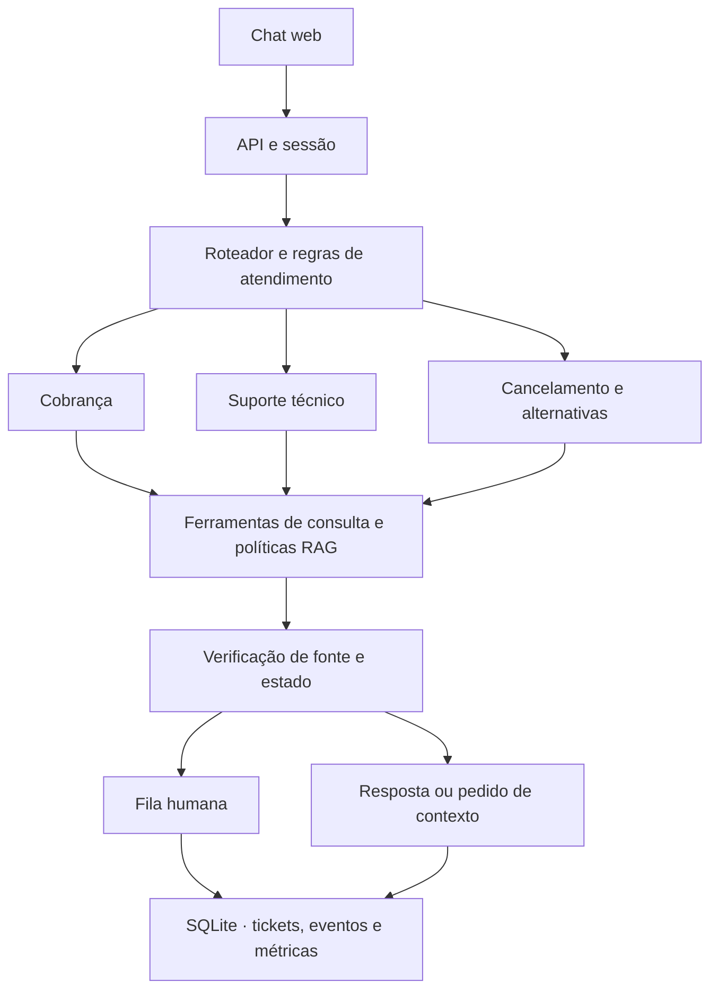
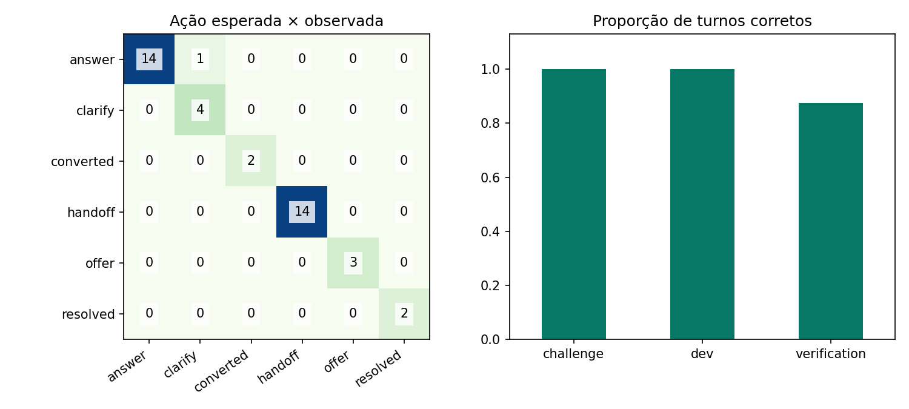

# Central Telecom

**Uma central de atendimento multiagente em português para explicar faturas, diagnosticar falhas de conexão e encaminhar pedidos de cancelamento.** O projeto acompanha a conversa desde a mensagem do cliente até a consulta às ferramentas, a política que sustenta a resposta, o protocolo recebido pela operação e os indicadores utilizados para avaliar a solução.

Imagine que um cliente diga **“Minha fatura veio mais cara e, se isso continuar, quero cancelar.”** No perfil A, o extrato fictício mostra R$ 79,00 de mensalidade e R$ 15,00 de adicionais. A aplicação explica os R$ 94,00 e pergunta se o cliente quer efetivamente encerrar o contrato. Um pedido explícito abre um protocolo com o histórico necessário para um atendente.

## O que esta entrega demonstra

**O que acontece quando o modelo entende “ajuda” como um pedido de cancelamento?** Na avaliação, o classificador sugeriu a área errada e o atendimento terminou antes do esclarecimento. O candidato agora exige evidência de que o assunto pertence ao escopo antes de enviar a pergunta ao especialista. O especialista propõe uma consulta estruturada, o servidor confere a ferramenta permitida, busca a política e produz o rascunho com os dados do perfil. O fluxo experimental de chamada nativa de ferramentas foi preservado para comparação.

| Evidência | Resultado observado | Onde conferir |
|---|---|---|
| Inferência real com Ollama e LangGraph, mesmas 34 conversas públicas | 34/40 turnos corretos antes do controle de escopo, **39/40** depois. A candidata final também obteve 39/40. Um pedido sobre mudança de valor continuou ambíguo | [Antes](reports/amostra_completa) · [Candidata final](reports/final) |
| Formulações adicionais congeladas antes da primeira rodada | **8/12** na primeira execução e **12/12** após corrigir a interpretação e repetir as mesmas perguntas | [Primeira rodada](reports/novas) · [Regressão](reports/regressao_novas) |
| FinOps, cinco conversas executadas duas vezes, com os mesmos modelos | Ao verificar no servidor a primeira política compatível, as chamadas passaram de 24 para 12 e os turnos corretos de 6/14 para 14/14 | [Medições pareadas](reports/finops.csv) |
| Dados conversacionais reais | 71.397 mensagens com resposta de suporte em três contas públicas de telecom. Mediana de 3,77 min e p90 de 23,11 min | [Agregados e figura](reports/campo) |
| Canal e transbordo | O chat consultou uma fatura com LLM real e repassou o histórico ao operador via HTTP | [Transcrição técnica do teste](reports/chat_final.json) |

A aplicação usa contas fictícias. O corpus histórico em inglês informa hipóteses sobre atendimento. Os replays avaliam regras, modelos e políticas em português. Tempo poupado pelos clientes e adoção por uma equipe precisam de um piloto. [Decisão e resultados](docs/EVIDENCIAS.md) · [Cada requisito da vaga](docs/VAGA.md) · [As oito etapas do CRISP-AI](docs/CRISP-AI.md).

## Abrir no Windows

**Visual Studio.** Extraia o ZIP. No Visual Studio Installer, habilite a carga de trabalho **Desenvolvimento em Python**. Abra `CentralTelecom.sln`. No terminal da solução, a pasta correta contém `main.py` e `requirements.txt`. A primeira instalação precisa de internet. O ambiente de referência usa Python 3.12 de 64 bits.

```powershell
py -3.12 -m venv .venv
.\.venv\Scripts\python.exe -m pip install -r requirements.txt
.\.venv\Scripts\python.exe main.py serve
```

Se o seu Python estiver em `$env:LOCALAPPDATA\Programs\Python\Python314\python.exe`, você também pode usar `& "$env:LOCALAPPDATA\Programs\Python\Python314\python.exe" -m venv .venv`. As dependências declaram faixas de versões. A combinação testada nesta entrega está em [docs/AMBIENTE.md](docs/AMBIENTE.md). Outra opção no PowerShell é executar `.\Iniciar.ps1` na raiz. Ele cria o ambiente quando necessário, instala os pacotes e inicia o chat.

Abra **http://127.0.0.1:8000**. Para depurar pelo Visual Studio, selecione o interpretador de `.venv` em **Python Environments** e pressione **F5**. No **VS Code**, abra a pasta extraída, selecione esse mesmo interpretador com **Python: Select Interpreter**, abra **Executar e Depurar** e escolha **Central Telecom · demonstração**. O terminal da aplicação fica aberto enquanto o chat está em uso. A documentação HTTP interativa está em `/docs`. [Suporte a projetos Python no Visual Studio](https://learn.microsoft.com/en-us/visualstudio/python/quickstart-01-python-in-visual-studio-project-from-existing-code?view=visualstudio)

## Roteiro de demonstração

1. No perfil **A · Centro**, envie a pergunta da introdução. Expanda **Conferir políticas**. Envie **Quero cancelar agora**, abra **Fila humana** e confira o resumo antes de marcar o protocolo como revisado.
2. Inicie outra conversa no perfil **B · Norte** e pergunte **Minha internet está sem sinal. Há alguma ocorrência?** A ferramenta informa a região e o protocolo NET-08. Envie **Resolveu** para registrar a confirmação da resolução.
3. No perfil A, pergunte **Existe desconto?**. A oferta só conta como conversão depois da mensagem **ACEITO A OFERTA**. Visite **Indicadores** e confira os denominadores descritos abaixo.

## Dois modos de execução

| Modo | Decisões e ferramentas | Uso |
|---|---|---|
| `demo`, padrão | Regras de intenção, ferramentas locais, índice de políticas e respostas controladas | Explorar o produto e reproduzir contratos em qualquer computador após instalar as dependências |
| `ollama` | No candidato, regras delimitam o domínio e o LLM seleciona a consulta por JSON. A variante nativa delega roteamento, tool calling e seleção de fonte ao LLM. O servidor verifica a decisão e compõe a orientação | Medir comportamento do modelo, comparar prompts, registrar tokens, custo e latência |

Para reproduzir a configuração avaliada, instale o Ollama, abra outro terminal e baixe os pesos. O 0.6b seleciona a ferramenta de cada especialista. O 1.7b atua como juiz offline. Para usar apenas o chat basta o primeiro. O arquivo `config/piloto.json` identifica as escolhas por papel.

```powershell
ollama pull qwen3:0.6b
ollama pull qwen3:1.7b
.\Iniciar.ps1 -Modo ollama
```

Para rodar um caso isolado com o juiz no terminal do projeto:

```powershell
$env:AGENT_CONFIG = "config/piloto.json"
.\.venv\Scripts\python.exe main.py evaluate --mode ollama --case D01 --judge
```

O executor padrão do chat é o nativo. Para reproduzir o benchmark com LangGraph no mesmo terminal, instale `requirements-graph.txt`, defina `$env:ORCHESTRATOR = "langgraph"` e execute `python scripts/benchmark.py --cases evaluation/cases.json --arms final --output runtime/meu-benchmark` com o Python do projeto. Cada execução precisa de uma pasta nova. A configuração original para experiências com qwen3:4b continua em `config/agents.json`. O servidor usa a porta 8000. Encerre uma instância anterior com Ctrl+C antes de iniciar outra.

Queda do modelo, chamada de ferramenta inválida ou fonte incompatível resultam em transbordo com motivo visível no trace. O modelo recebe contexto limitado a pergunta atual, última área, fatos da ferramenta e passagens recuperadas. A máquina de estados também conserva a revisão e a proposta pendente. [API de chat do Ollama](https://docs.ollama.com/api/chat)

## Arquitetura



O chat usa HTTP, FastAPI e SQLite. O índice combina TF-IDF e embeddings locais de semântica latente (LSA). Cada política tem identificador e hash. O modo Ollama implementa RAG com escolha de evidência estruturada. O texto final segue fatos e regras de negócio verificados. O cliente não pode trocar o perfil usando argumentos da ferramenta. O generalista de referência compartilha o mesmo CRM e catálogo.

**LangGraph e MCP.** O executor nativo e o grafo opcional usam os mesmos especialistas. Para executar o framework e o servidor MCP de políticas no fluxo:

```powershell
.\.venv\Scripts\python.exe -m pip install -r requirements-graph.txt
$env:ORCHESTRATOR = "langgraph"
$env:POLICY_TRANSPORT = "mcp"
.\.venv\Scripts\python.exe main.py evaluate --case D01
```

MCP abre um subprocesso Python por consulta nesta demonstração. Esse desenho facilita a inspeção do protocolo e aumenta a latência. O comando `python main.py mcp` inicia o servidor stdio para clientes MCP externos. Para voltar ao caminho nativo no PowerShell, use `Remove-Item Env:ORCHESTRATOR,Env:POLICY_TRANSPORT -ErrorAction SilentlyContinue`. [LangGraph](https://docs.langchain.com/oss/python/langgraph/graph-api) · [Python SDK do MCP](https://github.com/modelcontextprotocol/python-sdk)

## Evidências e resultados

O primeiro replay verificou 20/20 turnos de desenvolvimento e 9/12 turnos de desafio. Detectou três falhas, incluindo uma cobrança descrita como “duas vezes” que deveria gerar contestação. As correções elevaram o desafio a 12/12. A primeira execução de oito perguntas adicionais atingiu 6/8. Após corrigir um pedido de atendente negado e tratar um valor ambíguo por esclarecimento, o mesmo conjunto atingiu 7/8.

| Conjunto público da entrega | Conversas | Turnos corretos no modo demo |
|---|---:|---:|
| Desenvolvimento | 16 | 20/20 |
| Desafio incorporado à regressão | 10 | 12/12 |
| Verificação reutilizada após diagnóstico | 8 | 7/8 |

**39 de 40 turnos** atenderam ao gabarito na rodada final. A busca lexical atingiu recall@3 médio de 0,911. A busca densa e a híbrida chegaram a 0,929 nessa amostra. Há resultado por pergunta e registro do erro restante em [reports/example](reports/example). O ensaio é público, sintético e executado por regras. Os resultados do LLM real aparecem na tabela de abertura. O protocolo em docs/PILOTO.md mede o efeito com pessoas.



### Reproduzir

```powershell
.\.venv\Scripts\python.exe -m unittest discover -s tests -v
.\.venv\Scripts\python.exe main.py profile
.\.venv\Scripts\python.exe main.py evaluate
.\.venv\Scripts\python.exe main.py analyze --db runtime/telecom.sqlite3
```

A suíte desta entrega foi executada com LangGraph instalado. [Lista de testes e estados](reports/testes.md).

O benchmark cria banco temporário e salva cada execução separadamente em `reports/runs/`. O painel lê apenas o banco do chat. Para investigar o comportamento não determinístico do LLM, rode o mesmo conjunto ao menos três vezes com cada configuração:

```powershell
.\scripts\experimento.ps1 -Repeticoes 3 -Grupo verification -Juiz
```

O experimento compara **generalista**, **multiagente padrão** e **multiagente candidato**. Gera comparações pareadas e registra ganhos, perdas, tokens e p95. A candidata altera mais de uma variável. Para atribuir causalidade a temperatura, esforço ou orçamento, varie uma configuração por rodada mantendo as demais fixas. A escolha de modelo é independente por papel em `config/agents.json`. As configurações comparadas ficam gravadas em `summary.json`.

### Interpretar os indicadores

| Indicador | Como ler |
|---|---|
| Resolução confirmada | Conversas com confirmação explícita após orientação / conversas com ao menos um turno. Conversas abertas permanecem no denominador. |
| Transbordo | Conversas encaminhadas / conversas com turno. A fila separa cancelamento legítimo, falha técnica, contestação e outros motivos. |
| Conversão de oferta | Sessões com aceite confirmado / sessões em que uma oferta foi apresentada. É uma conversão simulada e pode ficar indefinida quando não há ofertas. |
| Latência p95 | 95º percentil da duração do motor por turno. O tempo humano de concluir a tarefa é medido no piloto. |
| Tokens e custo | Somatório reportado pelo provedor. Tarifas configuradas permitem estimar USD de inferência por conversa. Valores ausentes aparecem como “Sem medida”. |
| Qualidade | Ação, domínio, fonte e fatos por turno e sucesso integral por conversa. O juiz de linguagem é avaliado à parte, com calibração humana. |

## Competências demonstradas

| Competência | Onde verificar |
|---|---|
| Orquestração, especialistas, intenção, contexto e transbordo | `central/engine.py`, `central/graph.py`, chat, fila e resumo por ticket |
| System prompts e revisão antes de promover | `prompts/`, impressão digital do candidato, template de PR, `python main.py gate` e CI |
| Tool calling e saída estruturada | `central/provider.py`, `central/tools.py`, contratos HTTP, traces reais do protocolo nativo e planos JSON executados pelo servidor |
| RAG, embeddings, chunking e qualidade da recuperação | `central/knowledge.py`, `knowledge/`, `retrieval.csv` |
| MCP e framework de agentes | Servidor e cliente MCP stdio executados. LangGraph usado também na avaliação real |
| Regressão, bordas, juiz LLM e investigação | `tests/`, `evaluation/cases.json`, `central/evaluation.py`, relatórios antes/depois |
| FinOps, esforço, temperatura e compromisso entre qualidade e custo | Configurações por agente, traces de execução, experimento pareado |
| Observabilidade e análise conversacional | `central/storage.py`, `central/analysis.py`, painel, alertas, CSV e gráfico de eventos |
| Colaboração com produto, operação e engenharia | Roteiro de piloto, critério de aceite, protocolo de revisão e runbook |
| Operação em canal conversacional | Chat web implantável localmente, endpoint de saúde e teste HTTP em processo separado. Dados de uma operação comercial dependem de piloto autorizado. |

## Mapa do repositório

| Caminho | Conteúdo |
|---|---|
| `CentralTelecom.sln`, `CentralTelecom.pyproj`, `.vscode/` | Solução Visual Studio, projeto Python e configurações do VS Code |
| `main.py`, `Iniciar.ps1` | Comandos e inicialização no Windows |
| `central/web.py`, `ui/` | API, página, estilos e interação do navegador |
| `central/engine.py`, `graph.py`, `provider.py`, `tools.py` dentro de central | Coordenação, controles de negócio, adaptador de LLM e consultas |
| `central/knowledge.py`, `mcp_client.py`, `mcp_server.py` | Índice, embeddings e transporte das políticas |
| `central/storage.py` | Transações, sessões, tickets, eventos e métricas |
| `central/analysis.py`, `evaluation.py`, `comparison.py`, `release.py` | Perfil de dados, avaliação, comparação entre versões e decisão de promoção |
| `data/`, `knowledge/`, `config/`, `prompts/` | Dados públicos agregados, perfis fictícios, políticas autorais, parâmetros e instruções versionadas |
| `evaluation/`, `tests/`, `scripts/` | Gabaritos, testes de unidade/integração e experimentos executáveis |
| `reports/` | Perfil de dados, avaliação exportada, gráfico, histórico de iterações e resultados reproduzíveis |
| `docs/` | Metodologia, evidências, ambiente, operação e piloto |
| `requirements*.txt`, `Dockerfile`, `.dockerignore`, `.github/` | Dependências, contêiner, integração contínua e revisão de mudanças |
| `runtime/` | Criado ao executar. Banco local e arquivos de análise, ignorados pelo Git |

**Leitura guiada.** [As oito etapas do CRISP-AI](docs/CRISP-AI.md) · [Diagnóstico dos erros e decisão técnica](docs/RESULTADOS.md) · [Piloto e revisão independente](docs/PILOTO.md) · [Implantação, alertas e reversão](docs/RUNBOOK.md) · [Ambiente de validação](docs/AMBIENTE.md).


### Histórico Git incluído na entrega

O ZIP contém a pasta central-telecom com os arquivos para abrir diretamente e, ao lado, historico.bundle com os commits e tags da reconstrução. Para examinar as mudanças com o Git, execute no diretório extraído:

```powershell
git clone historico.bundle central-com-historico
git -C central-com-historico log --oneline --decorate
```

O bundle preserva a autoria técnica da montagem e as etapas do experimento. O modelo e os dados brutos externos são obtidos pelos comandos desta documentação. O template de PR está pronto para uma revisão humana no repositório de destino.
