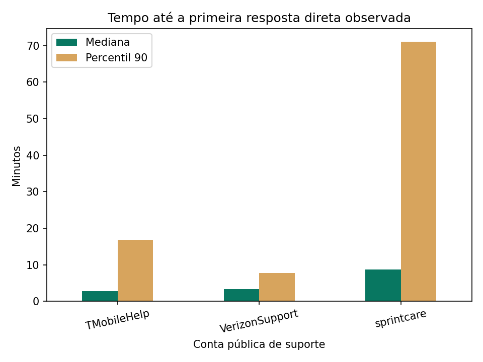

# O que mensagens reais de suporte revelam

Em três contas públicas de telecom nos dados da Thought Vector, metade das mensagens pareadas recebeu a primeira resposta direta observada em até 3,77 minutos. Uma em cada dez esperou mais de 23,11 minutos. A equipe de operação pode examinar a fila longa e os contatos recorrentes antes de escolher onde testar triagem assistida. A amostra é histórica, em inglês e de outro canal e país.



O script lê o ZIP em blocos usando pandas. Na primeira passagem, guarda IDs de mensagens às quais uma conta de suporte respondeu. Na segunda, busca o texto da mensagem de entrada para obter indicadores linguísticos. Faz a junção pelos IDs, converte os horários em UTC, elimina intervalos negativos e seleciona a resposta válida mais rápida por par marca–mensagem. Quatro nomes de conta foram pesquisados. Três apresentaram pares válidos. Uma mensagem pode ter resposta de mais de uma marca.

Dos 71.397 pares, 4.760 continham expressões como “still” ou “again”. São pistas para auditoria. Podem indicar insistência, uso coloquial ou outro significado. O corpus não fornece desfecho de resolução, custo, fila privada ou ganho causado pelo agente. Uma resposta rápida também pode ser apenas um pedido de dados.

Baixe o ZIP original e execute o comando abaixo. A classificação de temas é lexical e os indicadores podem se sobrepor. Os arquivos CSV e JSON trazem denominadores, marcas e o hash do download. O repositório distribui somente a análise agregada. Crédito da base *Customer Support on Twitter* à Thought Vector. Para os agregados e a figura derivados da base, aplica-se CC BY-NC-SA 4.0. [Origem e termos](https://www.kaggle.com/datasets/thoughtvector/customer-support-on-twitter) · [Licença](https://creativecommons.org/licenses/by-nc-sa/4.0/).

```powershell
python -m central.field_data C:\dados\customer-support-on-twitter.zip --output runtime/analise_campo
```
